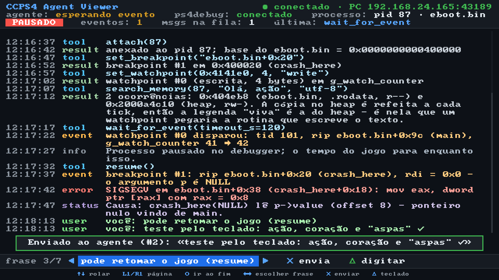

# CCPS4 Agent Viewer (fase 6, opcional)

App do PS4 que mostra, na TV, o que o agente (Claude Code + `ps4-mcp` no PC)
está fazendo, e deixa quem está no sofá mandar mensagens para ele: frases
prontas com o controle ou texto livre pelo teclado do sistema.

| | |
|---|---|
| Título | CCPS4 Agent Viewer |
| TITLE_ID | `CCPS00001` |
| CONTENT_ID | `IV0000-CCPS00001_00-CCPS4AGENTVIEWER` |
| Lado do PC | `ps4_mcp/bridge.py` (liga com `PS4_BRIDGE=1`), protocolo v1 abaixo |


(o PNG é gerado por `make host-test`, desenhado pelo mesmo código que roda no PS4)

## Limitações (leia antes)

- **O app é suspenso quando um jogo está em primeiro plano.** O PS4 só roda um
  app de primeiro plano; ao abrir o jogo, o viewer congela (a rede dele também)
  e volta a atualizar quando você volta para ele. Não é um overlay. Uso
  pensado: entre execuções do jogo, ou com o jogo parado no debugger — você
  alterna para o viewer pela tela inicial (o jogo fica suspenso; o processo do
  jogo continua pausado no ps4debug), lê o que o agente concluiu, responde, e
  volta. Se o sistema fechar o jogo ao abrir o viewer no seu firmware, use o
  viewer entre execuções.
- Ao voltar de uma suspensão a primeira requisição pode falhar; o app mostra
  "desconectado" e reconecta em 3 s sozinho.
- Fonte 8x8 (ASCII + Latin-1, então acentos do português funcionam); outros
  caracteres (CJK, emoji) aparecem como `?`. Aspas curvas, travessões, `…`,
  setas e `✓` são mapeados para glifos equivalentes.
- Horários do feed: convertidos com `utc_offset` (padrão −180 = Brasília).
- **Ainda não foi executado num PS4** — ver "O que foi validado".

## Instalar

```bash
scripts/install_openorbis.sh                         # uma vez, na raiz do repo
export OO_PS4_TOOLCHAIN=$HOME/tools/OpenOrbis/PS4Toolchain
make -C ps4-app                                      # -> ps4-app/build/IV0000-CCPS00001_00-CCPS4AGENTVIEWER.pkg
```

Copie o `.pkg` para um pendrive ou `/data/pkg/` (FTP) e instale pelo
instalador de pacotes do GoldHEN (*Debug Settings → Package Installer*).

No PC, ligue o bridge do `ps4-mcp` (`PS4_BRIDGE=1`). Ele anuncia o PC na rede
local a cada 2 s; o app acha sozinho.

## Configuração (opcional): `/data/ccps4/viewer.cfg`

Na primeira execução o app cria `/data/ccps4/` e um `viewer.cfg.exemplo`.
Para fixar o PC (por exemplo, se o roteador bloqueia broadcast), crie
`/data/ccps4/viewer.cfg` por FTP:

```
host=192.168.0.10     # IP do PC; com host definido a descoberta UDP é desligada
port=8765             # porta HTTP do bridge (padrão 8765)
utc_offset=-180       # fuso dos horários, em minutos
font_scale=3          # 3 (padrão, para o sofá) ou 2 (cabe mais texto)
udp_port=8766         # porta da descoberta (só mude se mudou no PC)
```

Linhas `#` são comentários; chaves desconhecidas são ignoradas.

## Controles

| Botão | Ação |
|---|---|
| ↑ / ↓ (segurar repete) | rolar o feed uma linha |
| L1 / R1 | página para cima / para baixo |
| ○ | voltar ao fim (mais novo) |
| ← / → | escolher frase pronta |
| ✕ | enviar a frase escolhida |
| △ | abrir o teclado do sistema e enviar texto livre (até 512 bytes) |

Frases prontas: "continue", "pare e me explique o que achou", "pode retomar o
jogo (resume)", "sim", "não", "tira um snapshot agora", "resume em 3 linhas o
que você sabe". Depois de enviar aparece um aviso ("Enviado ao agente (#id)")
e o eco "você: ..." chega pelo feed. Sem teclado disponível o app mostra
"teclado indisponível" e continua funcionando. Se o envio falhar, o texto
digitado volta preenchido na próxima vez que abrir o teclado.

Tela: barra de status (conexão, IP:porta do PC, estado do agente, ps4debug,
pid/processo anexado, PAUSADO, eventos pendentes, mensagens na fila, última
ferramenta), feed com o mais novo embaixo (cores por tipo: tool azul, result
verde-claro, event laranja, status lilás, user verde, info cinza, error
vermelho), barra da frase escolhida e ajuda dos botões.

## Protocolo bridge v1 (resumo)

- **Descoberta:** o PC manda UDP para `255.255.255.255:8766` a cada 2 s com
  `CCPS4-BRIDGE v1 http=<porta>\n`; o IP do PC é o remetente do datagrama.
  Com `host=` no `viewer.cfg` a descoberta é pulada.
- **HTTP/1.0**, uma requisição por conexão (`Connection: close`), resposta
  sempre com `Content-Length` (o cliente também aceita corpo até o EOF).
- `GET /v1/feed?since=<seq>` → linhas `<seq>\t<unix_ts>\t<tipo>\t<texto>\n`
  (seq crescente ≥ 1; tipos tool/result/event/status/user/info/error; texto
  UTF-8 ≤ 300 bytes; até 100 linhas; `since=0` = as 100 últimas).
- `GET /v1/state` → `chave=valor\n`: `agent`, `ps4debug`, `attached_pid`,
  `process`, `paused`, `pending_events`, `last_tool`, `messages_pending`
  (chaves desconhecidas são ignoradas).
- `POST /v1/message` (UTF-8, 1..512 bytes) → `200 ok <id>`, `400` vazia/grande,
  `403` não permitido.
- O app consulta state + feed ~1x/s; em erro de rede mostra "desconectado" e
  tenta de novo a cada 3 s (refazendo a descoberta se não há `host=`). Depois
  de reconectar pede `since=0`; se o maior seq do PC for menor que o visto, o
  bridge reiniciou e o feed é recarregado. Linhas malformadas são ignoradas e
  contadas; páginas cheias (100) são seguidas de outro pedido imediato.

## Arquitetura

```
src/core/      independente de plataforma (compila com gcc no Linux e clang p/ PS4)
  utf8.c       decodificador UTF-8 estrito, UTF-16<->UTF-8, corte sem quebrar caractere
  font.c       font8x8 (domínio público) + glifos de UI próprios
  wrap.c       quebra de linha por palavras (colunas = code points)
  http.c       montagem de GET/POST e parser incremental de resposta HTTP
  bridge.c     parsers do protocolo (descoberta, viewer.cfg, feed, state, "ok <id>")
  httpc.c      transação HTTP não bloqueante (avança um pouco a cada quadro)
  viewer.c     máquina de estados: descoberta, polling, reconexão, envio, UI
  render.c     desenho em ARGB8888 na memória (status, feed, frases, ajuda, avisos)
src/net_bsd.c  sockets BSD não bloqueantes — o MESMO arquivo no Linux e no PS4
src/platform_ps4.c   VideoOut + flip, scePad, sceImeDialog, relógio, log, main()
src/platform_host.c  Linux: relógio, log, teclado simulado, quadros em PPM
test_host/     testes no host (abaixo)
tools/make_icon.py   gera sce_sys/icon0.png (512x512) só com a stdlib
```

`src/core/font8x8_basic.h` e `font8x8_ext_latin.h` são cópias sem alteração de
<https://github.com/dhepper/font8x8> (Public Domain, Daniel Hepper; derivados de
fontes VGA de domínio público), com o aviso original no topo de cada arquivo.

## Testes no PC

```bash
make -C ps4-app host-test
```

1. `build/host/test_core` — 177 verificações (gcc, `-Werror`, ASan + UBSan):
   parser HTTP (resposta inteira e byte a byte, LF puro, `Content-Length`
   ausente → corpo até o EOF, truncado, duplicado, inválido, chunked, linha
   gigante, corpo maior que o buffer), feed (linhas malformadas, seq repetido/fora
   de ordem, CRLF, última linha sem `\n`, texto > 300 bytes cortado sem quebrar
   UTF-8, tipo desconhecido, TAB/controle no texto), state, descoberta,
   `viewer.cfg`, UTF-8 (overlong, surrogate, truncado, > U+10FFFF), UTF-16,
   quebra de linha, fonte (acentos e `?`), recorte do desenho, rolagem.
2. `test_host/run_host_test.sh` — sobe `test_host/bridge_stub.py` (stub do
   protocolo v1, só stdlib, com anúncio UDP de verdade e linhas malformadas
   injetadas) e roda `build/host/e2e_main`: descobre o PC por broadcast, lê state
   e feed, testa "teclado indisponível", envia a frase 3 com ✕ e um texto pelo
   teclado simulado com △, confere o eco no feed, rola, derruba o stub e confere
   "desconectado". O script confirma que o stub **recebeu** as 2 mensagens com os
   bytes UTF-8 exatos e gera `build/host/screenshots/viewer_{online,scrolled,offline}.png`.

## O que foi validado e o que não foi

Validado no PC:
- o PKG é gerado pelo toolchain OpenOrbis v0.5.4 e passa no `PkgTool.Core
  pkg_validate` (todos os hashes/assinaturas `[OK]`); `param.sfo` conferido com
  `sfo_listentries`; o ELF é x86-64 PIE e importa só funções que existem nos
  stubs do toolchain;
- todo o núcleo (protocolo, parsers, UTF-8, quebra de linha, desenho, máquina de
  estados) e a camada de sockets (`net_bsd.c`) rodando de verdade contra o stub;
- a tela, inspecionada nos PNGs gerados.

Não validado (precisa de um PS4 com GoldHEN):
- se o app abre (fake PKG + `sce_module` dos samples do OpenOrbis);
- VideoOut (formato `0x80000000` A8R8G8B8 linear, como o sample `graphics`),
  `scePadReadState`, `sceImeDialogInit`/`GetStatus`/`GetResult` (o teclado é o
  ponto mais incerto: layout de `OrbisImeDialogSetting` e uso de `wchar_t` de 16 bits
  vêm dos headers do OpenOrbis), `sceSysmoduleLoadModule(IME_DIALOG)`;
- sockets BSD da libkernel em modo não bloqueante (`fcntl O_NONBLOCK`, `poll`,
  `SO_NOSIGPIPE`), recepção de broadcast UDP no console;
- comportamento ao suspender/retomar o app com um jogo aberto.
